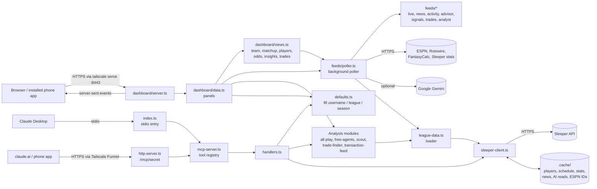

# Sleeper MCP: Project Description

A read-only toolkit for one Sleeper fantasy football league. It has two parts
that share one codebase:

1. **An MCP server** with 23 tools, so you can ask "who should I pick up?",
   "who's lucky?" or "find me a trade" in a normal Claude chat and get answers
   from live league data. It runs two ways:
   - **stdio:** Claude Desktop starts it on your computer.
   - **HTTP:** it runs on a server behind a public HTTPS address (Tailscale
     Funnel) as a claude.ai custom connector, which also makes the tools work
     in the Claude phone app.
2. **A web dashboard** (`npm run dashboard`) styled after the Sleeper app,
   installable on a phone's home screen. Tabs: HOME (recommendations and
   season analytics), MATCHUP (live, slot by slot, any week or matchup), TEAM
   (lineup with start/sit tips), WAIVERS (add/drop advisor), LEAGUE (playoff
   odds, standings, every league trade evaluated), TRADE (trade suggestions,
   position strength, offer evaluator) and NEWS, plus a players pane (search,
   available, trending, leaders, activity) and a sheet for any player. A
   background poller feeds it live scores every 2 seconds while your players
   are on, play-by-play, news per player, projections and trade values, and an
   optional Gemini model reads each player's news.

Both use the same Sleeper client and caches; projections everywhere are
Sleeper's own, so numbers match the Sleeper app.

Setup and connection steps are in [SETUP.md](SETUP.md).

---

## Contents

1. [Goals and ground rules](#1-goals-and-ground-rules)
2. [Architecture](#2-architecture)
3. [Repository layout](#3-repository-layout)
4. [Data: Sleeper API and caching](#4-data-sleeper-api-and-caching)
5. [Configuration and defaults](#5-configuration-and-defaults)
6. [Tool catalogue](#6-tool-catalogue)
7. [How the analysis works](#7-how-the-analysis-works)
8. [Dashboard](#8-dashboard)
9. [Testing](#9-testing)
10. [Limitations](#10-limitations)
11. [Changes from upstream](#11-changes-from-upstream)
12. [Ideas for later](#12-ideas-for-later)

---

## 1. Goals and ground rules

- **Answer real league questions from live data.** Who to pick up, who to
  trade with, who's good versus lucky, what the opponent's weak spots are.
- **No repeated typing.** Your username and league are set once and used by
  default everywhere.
- **Read-only.** The Sleeper API can't make moves, and the project doesn't try
  to. Nothing scrapes or automates the Sleeper app.
- **Be a good API citizen.** Stay well under Sleeper's ~1000 calls/minute and
  download the 5 MB player database at most once a day.
- **Own the code.** It's a fork of
  [FloSchl8/sleeper-mcp](https://github.com/FloSchl8/sleeper-mcp) (MIT), so it
  can be changed freely. New code follows the existing TypeScript + Zod style,
  and every new tool has tests.

## 2. Architecture



**Three front ends, one core.** The stdio MCP server (`src/index.ts`), the
HTTP MCP server (`src/http-server.ts`) and the dashboard
(`src/dashboard/server.ts`) are thin layers. Both MCP entry points build their
server with the same `createMcpServer()` in `src/mcp-server.ts`. All Sleeper access goes
through `SleeperClient`, and all calculation lives in small modules made of
pure functions that don't touch the network. That split is what makes the
analysis testable offline and keeps the two front ends consistent.

**Request flow (MCP).** Claude calls a tool. `index.ts` passes the name and
arguments to `handleToolCall`. `DefaultsResolver` fills in any missing
`username_or_id`, `user_id`, `league_id` or `season`. The handler validates
the arguments with Zod, fetches through the client, runs the analysis and
returns JSON. Errors come back as `{ success: false, error }` instead of
crashing the server.

**Request flow (dashboard).** The browser loads static files, calls
`/api/<panel>` for each panel, and opens `/api/stream` for live updates. The
server resolves your league and user once. Simple panels call the loader and
analysis modules directly; the rest read the background poller's latest state
(`views.ts` computes team, matchup, players, odds, insights and trades on
request; feed panels return the poller's snapshots).

**Request flow (HTTP MCP).** claude.ai sends a JSON-RPC POST to
`https://<server>.ts.net/mcp/<secret>`. Tailscale Funnel ends the HTTPS
connection and forwards it to `127.0.0.1:3031`. `http-server.ts` checks the
secret path with a constant-time compare (any other path is a plain 404),
reads the body (1 MB limit), and hands it to a fresh MCP server and SDK
`StreamableHTTPServerTransport` in **stateless** mode with JSON responses.
There are no sessions to store, expire or leak. Each request stands alone,
which suits a single user on a home server. The tools, defaults and caches
are the same as in stdio mode.

## 3. Repository layout

```
sleeper-mcp/
├── src/
│   ├── index.ts              MCP entry point: stdio (Claude Desktop)
│   ├── http-server.ts        MCP entry point: HTTP at /mcp/<secret> (claude.ai, phone)
│   ├── mcp-server.ts         createMcpServer(): tool registry shared by both entry points
│   ├── tools.ts              Tool list: Zod schemas + JSON schemas for Claude
│   ├── handlers.ts           One handler per tool
│   ├── sleeper-client.ts     All HTTP calls, request cache, player + schedule disk cache
│   ├── config.ts             SLEEPER_USERNAME / LEAGUE_ID / DASHBOARD_* from env or .env
│   ├── defaults.ts           Fills missing username, user_id, league_id, season
│   ├── league-data.ts        Loads league, rosters, users, scored weeks, players, schedule
│   ├── season.ts             Shared pure helpers: ppg, byes, opponents, optimal lineup
│   ├── all-play.ts           All-play records, expected wins, luck
│   ├── free-agents.ts        Trending adds minus league rosters
│   ├── scout.ts              Opponent scouting report
│   ├── trade-finder.ts       Position report + win-win trade search
│   ├── transaction-feed.ts   Readable league activity feed
│   ├── types.ts              Sleeper API types
│   ├── utils.ts              Upstream helpers (unchanged)
│   ├── feeds/
│   │   ├── poller.ts         Background poller: schedules, snapshots, live events, state for views
│   │   ├── live.ts           ESPN scoreboard, live sides, pace, win chance, score events
│   │   ├── news.ts           Rotowire/ESPN news parsing, player matching, tagging, dedupe
│   │   ├── activity.ts       Play-by-play matching for the activity stream
│   │   ├── analysis.ts       League-scored projections, usage trends, points allowed, schedule, values
│   │   ├── signals.ts        News reading, games actually played, market signals, outlooks
│   │   ├── advisor.ts        Waiver advisor: lineup-based add/drop moves and drop candidates
│   │   ├── trades.ts         Position strength, trade evaluation, suggestions, played-out results
│   │   ├── analyst.ts        Optional Gemini article reader (model fallback, search grounding)
│   │   ├── rss.ts            Minimal RSS parser
│   │   └── http.ts           fetch with timeout and generic User-Agent
│   └── dashboard/
│       ├── server.ts         node:http server: static files, JSON API, /api/stream (SSE)
│       ├── data.ts           Panel registry; starts the poller
│       └── views.ts          Team, matchup, players, player sheet, playoff odds, insights, trades
├── dashboard/public/         Frontend: index.html, app.js, charts.js, dom.js, refresh.js,
│                             styles.css, manifest.webmanifest, icons
├── test/                     Offline unit tests (node:test), one file per module
├── test.mjs                  Upstream MCP protocol tests (live API)
├── scripts/smoke.mjs         Call any tool against the live API from the terminal
├── .env.example              Config template (copy to .env)
├── SETUP.md                  Install, connect, run, deploy
└── PROJECT.md                This file
```

## 4. Data: Sleeper API and caching

### Endpoints used

All from `https://api.sleeper.app/v1` unless noted. No authentication.

| Endpoint | Used for |
| --- | --- |
| `/state/nfl` | Current season, week, season type |
| `/user/{name}` | Username → user ID |
| `/user/{id}/leagues/nfl/{season}` | Finding your league |
| `/league/{id}` | Name, roster slots, scoring week settings, playoff start |
| `/league/{id}/rosters` | Who owns whom; records; IR and taxi |
| `/league/{id}/users` | Display and team names |
| `/league/{id}/matchups/{week}` | Scores, starters, **per-player points** |
| `/league/{id}/transactions/{week}` | Trades, waivers, FAAB, picks |
| `/players/nfl` | Full player database (~5 MB download, 19 MB on disk) |
| `/players/nfl/trending/add`, `/drop` | Sleeper-wide add and drop counts (market signal) |
| `https://api.sleeper.app/schedule/nfl/regular/{season}` | NFL schedule (undocumented; see below) |

The schedule endpoint isn't in Sleeper's public docs, but it's the same public
API Sleeper's own app uses. The code treats it as optional: if it fails, bye
and opponent info is simply left blank.

### Caching layers

| Layer | What | Lifetime | Why |
| --- | --- | --- | --- |
| Disk: `.cache/players.json` | Player database | 24 h | Sleeper asks for at most one download a day |
| Disk: `.cache/schedule-{season}.json` | NFL schedule | 24 h (5 min for live dashboard panels) | Bye weeks and opponents; game status during games |
| Memory: request cache | Every other GET | 30 s default | Lets parallel dashboard panels share one call |
| Memory: past-week matchups | Weeks before the current one | 1 h | Final scores don't change |
| Memory: trending adds/drops | Trending lists | 5 min | Changes slowly |
| Disk: `.cache/stats-{season}-w{n}.json` | Weekly stats, all players | Finished weeks kept; latest refetched daily | Usage trends, points allowed, game logs |
| Disk: `.cache/news.json` | Player news | Last 400 items | Keeps news across restarts |
| Disk: `.cache/ai-reads.json` | Gemini reads | Until a player's news changes (or 6-24 h) | Avoids re-reading unchanged news |
| Disk: `.cache/espn-ids.json` | Sleeper → ESPN player IDs | Permanent | Per-player news for players Sleeper lacks an ID for |

The dashboard's other outside feeds (ESPN, Rotowire, FantasyCalc, Sleeper's
stats and projections endpoints) are listed under [Live feeds](#live-feeds-srcfeeds).

The request cache also merges identical requests that are in flight at the
same moment, and drops failed requests so they're retried. A full dashboard
load makes about 20 API calls the first time and far fewer after that, nowhere
near the rate limit.

## 5. Configuration and defaults

Settings come from real environment variables first, then a gitignored `.env`
file in the repo folder (found relative to the code, so it works whatever
folder Claude Desktop starts in):

| Variable | Default | Meaning |
| --- | --- | --- |
| `SLEEPER_USERNAME` | (none) | Whose team "my" means |
| `SLEEPER_LEAGUE_ID` | your only league this season | Default league |
| `DASHBOARD_HOST` | `127.0.0.1` | `0.0.0.0` to allow other devices |
| `DASHBOARD_PORT` | `3030` | Dashboard port |
| `LIVE_POLL_SECONDS` | `2` | Score polling while one of your players is in a game (1-60) |
| `GEMINI_API_KEY` | (none) | Turns on the AI article reader |
| `GEMINI_MODELS` | `gemini-flash-latest,gemini-3-flash-preview,gemini-3.1-flash-lite` | Models to try, in order |
| `MCP_HTTP_HOST` / `MCP_HTTP_PORT` / `MCP_HTTP_SECRET` | `127.0.0.1` / `3031` / (none) | HTTP MCP endpoint (see SETUP.md) |

`DefaultsResolver` applies them per tool:

- **Username:** `get_user_info` with no name uses `SLEEPER_USERNAME`.
- **User ID:** tools that need `user_id` accept a numeric ID, a username
  (looked up once and cached), or nothing (uses `SLEEPER_USERNAME`).
- **League:** missing `league_id` → `SLEEPER_LEAGUE_ID` → otherwise your leagues
  this season: one league is used automatically, and several produce an error
  that lists them.
- **Season:** defaults to the current NFL season, not a hardcoded year.

## 6. Tool catalogue

### New in this fork

| Tool | Answers | Key inputs (all optional) |
| --- | --- | --- |
| `get_trending_free_agents` | "Who should I pick up?" | `position`, `lookback_hours`, `limit` |
| `get_all_play_records` | "Who's good and who's lucky?" | `through_week` |
| `get_opponent_scout` | "What's my opponent's weak spot?" | `week` |
| `get_transaction_feed` | "What has my league been doing?" | `since_week`, `type`, `limit` |
| `find_trade_partners` | "Who should I trade with, and for what?" | `target_position`, `limit` |

### Upstream tools (kept)

| Tool | Notes |
| --- | --- |
| `get_user_info`, `get_user_leagues` | Now default to your username and the current season |
| `get_league_info`, `get_league_rosters`, `get_league_users` | Raw league data |
| `get_current_matchups`, `get_matchup_details` | This week's pairings and lineups |
| `get_nfl_state` | Season and week |
| `search_players`, `get_player_details`, `compare_players` | Player lookups |
| `get_trending_players` | Sleeper-wide adds and drops (not league-filtered) |
| `get_waiver_suggestions` | Fixed to skip players rostered anywhere in the league |
| `get_transactions` | Raw transactions for one week |
| `analyze_lineup`, `get_start_sit_advice` | Use Sleeper's search rank as a stand-in for projections (rough) |
| `research_player_status` | Its "web research" results are placeholders from upstream |
| `clear_cache` | Forces a fresh player download |

## 7. How the analysis works

### Season data (`season.ts`, `league-data.ts`)

Weekly matchup objects include `players_points` (points for every rostered
player that week) and `starters_points` (points per starting slot, in roster
slot order). Combined over all **fully scored** regular-season weeks, these
give real per-player, per-slot numbers in your league's own scoring, which is
better than any generic ranking.

- **Scored weeks** end at the league's `last_scored_leg`, so a week still in
  progress never skews the season numbers. Playoff weeks are never counted.
- **Points per game** skips weeks where a player scored exactly 0 (bye,
  injury, inactive), so missed games don't drag a starter down.
- **Optimal lineup:** given players, slots and a value per player, it fills
  the most restrictive slots first (QB, RB, WR, TE, K, DEF, then the WR/RB and
  WR/TE flex slots, then FLEX, then SUPER_FLEX), each time taking the best
  eligible player left. Taking restrictive slots first means a flex spot
  never uses a player a dedicated slot needed.
- **Byes and opponents:** a team missing from a week's schedule is on bye.
  Opponents show as `vs KC` (home) or `@ KC` (away).

### All-play records (`all-play.ts`)

Each week, every team is compared with every other team: higher score is a
win, equal is a tie. Over 9 weeks in a 12-team league, that's 99 "games" per
team, which is a far steadier measure of strength than 9 head-to-head
results.

- **Expected wins** = for each week, the share of teams you outscored, summed
  over weeks. It's how many games your scores "deserved".
- **Luck** = actual head-to-head wins − expected wins. Positive means you won
  more than your scoring earned. Luck adds up to about zero across the league.
- **Actual records** are rebuilt from the same weeks' matchups, not copied
  from the roster settings, so both records always cover the same weeks (this
  matters for `through_week`). They were checked against Sleeper's own records
  for all 12 teams.
- **Median leagues:** if the league also plays everyone against the weekly
  median, those games count in the actual record but not in luck, since score
  alone decides them.

### Trending free agents (`free-agents.ts`)

The tool takes Sleeper's top 100 trending adds and removes any player on any
roster in the league, counting IR and taxi as taken. It also drops positions
the league doesn't start (no linebackers in a non-IDP league), using the
league's roster slots with flex slots expanded. Results stay in add-count
order and keep their Sleeper-wide rank. In this league, about 60 of the top
100 adds are usually taken already, which is why the filter matters.

### Opponent scout (`scout.ts`)

For the week's head-to-head opponent, the report covers:

- **Lineup:** each starting slot with the player, NFL matchup, live points,
  season ppg, and flags: `EMPTY SLOT`, `ON BYE`, `OUT` / `IR` / `DOUBTFUL` /
  `SUSPENDED`, or `Questionable`.
- **Lineup problems:** the flagged starters in one list.
- **Weak spots and strengths:** their season average for each starting slot
  (from `starters_points`) minus the league average for that slot. The three
  most negative are weak spots and the three most positive are strengths. This
  shows patterns such as "their TE slot averages 5 points below the league".
- **Bench depth** by season ppg, and **recent moves** (completed adds, drops
  and trades over the last three weeks, with FAAB bids).

### Trade finder (`trade-finder.ts`)

1. **Value:** season ppg, scaled down when a player has fewer than 3 games
   (one big week doesn't make a star).
2. **Position report:** for QB, RB, WR and TE, your best lineup's average at
   the dedicated slots is ranked against every team. Top third is a strength,
   bottom third is a need. "Surplus" means bench players at a position who'd
   start for at least the weakest team.
3. **Search:** every 1-for-1 swap between your QB/RB/WR/TE players and every
   other team's is tested. For each swap, both teams' best lineups are
   recalculated. A trade is kept only if **your lineup gains at least 0.25 ppg
   and theirs gains too**. Those are trades a rational manager could accept.
4. **Fairness:** value over replacement (VOR) puts positions on one scale.
   Replacement level is the first non-starter at each position league-wide
   (for example the 13th-best QB in a 12-team, 1-QB league). You can't ask for
   more than `max(1.5, 30% of what you send)` VOR above what you give. Without
   this check, "my backup RB for your 22-ppg QB" could pass just because it
   helps both lineups.
5. **Ranking:** ideas are ordered by the *smaller* of the two lineup gains, so
   balanced deals beat lopsided ones. Each partner appears at most twice.

### Transaction feed (`transaction-feed.ts`)

Only completed moves are kept (failed waiver claims are dropped), each one
once, newest first. Each move is split into sides (players added, players
dropped, draft picks received with their original owner, FAAB received). It
gets a one-line summary, for example *"Trade: Team A gets Matthew
Stafford (QB, LAR)…; Team B gets Brock Purdy (QB, SF)"*. The
feed also counts moves by type and by team.

## 8. Dashboard

### Server (`src/dashboard/server.ts`)

- Plain `node:http`, with no web framework and no extra dependencies.
- `GET /` and static files come from `dashboard/public/`.
  `GET /api/<panel>` returns `{ data, updated }`. Panels: `summary`,
  `standings`, `matchups`, `roster`, `free-agents`, `transactions`, `live`,
  `activity`, `news`, `usage`, `outlook`, `values`, `advice`, `ai`, `feeds`,
  `team`, `matchup` (`?week=&id=`), `players`, `player` (`?id=`), `odds`,
  `insights`, `trades` and `trade-eval` (`?partner=&give=&get=`). Query
  parameters are validated. `GET /api/stream` is a server-sent event stream
  (at most 20 open, heartbeat every 25 s). `GET /api/health` is a liveness
  check.
- **Read-only:** anything other than GET or HEAD gets `405`.
- **Hardening:** static paths are normalized and must stay inside the public
  folder, which blocks path traversal like `/../.env`. A strict
  Content-Security-Policy allows only same-origin scripts, styles and
  requests. Panel names are checked as the object's own keys, so
  `/api/constructor` can't reach built-in object properties.
- **Failures:** a panel error returns `502 { error }`, and only that panel
  shows the message with a Retry button. The rest of the page keeps working.
- Host and port come from config. If the port is taken, startup fails with a
  clear message.

### Live feeds (`src/feeds/`)

The dashboard process also runs a background poller (`feeds/poller.ts`) that
pulls outside data on its own schedule and pushes changes to open pages as
server-sent events (`GET /api/stream`). Every feed is public, needs no login,
and is read with a generic User-Agent.

| Feed | Source | Used for |
| --- | --- | --- |
| League scores | Sleeper `/league/{id}/matchups/{week}` | Live points in your scoring |
| Live stat lines | Sleeper `/v1/stats/nfl/regular/{season}/{week}` | "6 rec (8 tgt) 74 yd" |
| Projections | Sleeper `/projections/nfl/{season}/{week}` (this week, with fresh injury status) and `/v1/projections/…/{week}` (every remaining week) | Every projection shown, projected finals, win chance, start/sit, the waiver advisor, playoff odds and trades; re-scored with your league settings |
| Player news (per player) | ESPN fantasy news API, `?playerId=` for each of your players and the advisor's top pickups | Rotowire blurbs and analysis for exactly your players |
| Game state | ESPN scoreboard API | Clock, score, possession, red zone, last play |
| Play-by-play | ESPN game summary API | Activity stream: every play involving one of your players |
| Player news | Rotowire NFL RSS, ESPN news API | News tagged mine / league / free agent and returning / injury / role / move |
| Weekly stats | Sleeper `/stats/nfl/{season}/{week}` | Snap, target and carry share; points allowed by defense |
| Trade values | FantasyCalc `/values/current` | Redraft values matched to your league's format |

**How often.** The poller decides each feed's next run from the game state:

| Mode | When | Scores | Game clock / stat lines | News |
| --- | --- | --- | --- | --- |
| Fast | One of **your** rostered players is in a game | every `LIVE_POLL_SECONDS` (default 2 s) | every 5 s with the page open, 30 s without | headlines every 1 min; per-player rolling every 45 s |
| Game day | Any game live, or kickoff within 15 min | every 1 min | every 30-60 s | headlines every 1 min; per-player rolling every 1 min |
| Idle | Otherwise | every 10 min | every 10-30 min | headlines every 2 min; per-player rolling every 1 min |

This week's projections refresh every 15-30 minutes and later weeks' every 6
hours; weekly stats and trade values every 6 hours; AI reads every 3-10
minutes (only players whose news changed). Finished weeks of stats are cached on disk (`.cache/stats-*.json`), and
news is kept in `.cache/news.json` (last 400 items). A failing feed keeps its
last good data and backs off, doubling up to 15 minutes.

**Matching news to players.** Rotowire links carry Rotowire's player ID and
ESPN tags athletes with ESPN IDs; Sleeper's player database has both. A name
match is the fallback, and only when exactly one player on an NFL team has
that name.

**Usage risers** compare each RB/WR/TE's last two games with their earlier
games (at least two). Rank = change in targets + carries a game, plus the
snap-share change (each 10 points of snap share counts as 2). A growing role
predicts breakouts better than one big week.

**Schedule strength** sums the fantasy points (your scoring) every defense
allowed to each position per game this season and ranks them 1-32 (1 = gives
up the most = easiest). Each of your players gets the rank for every remaining
opponent through the fantasy playoffs, plus averages for rest of season and
playoffs.

**Waiver advisor** (`feeds/advisor.ts`, Waivers tab). For every week left
through the fantasy playoffs it builds your best lineup from projections (in
your scoring), and sums those weeks: your rest-of-season (ROS) starting
points. Every free agent worth testing (the best ROS projections at each
startable position, plus anyone trending or with a growing role) is tried
against every player on your roster (IR and taxi spots excluded). Each add
keeps its least costly drop, and moves are ranked by how much they raise ROS
starting points, with the playoff-weeks and this-week gains alongside. Because
it works on whole lineups, byes, injuries (an out player projects 0),
position needs and flex eligibility are all counted, and a good backup who'd
never start doesn't show as an upgrade.

Each move lists reasons for both sides, built from: ROS points a game and
games left, role changes (snap share and targets + carries, last two games vs
before), recent scoring (last three games vs season), playoff schedule
strength, Sleeper-wide adds in the last 24 h, FantasyCalc value, injury status
and the latest news. **Drop candidates** lists your players by how many
starting points your lineups lose without each one (under 3 = drop, under 12
= expendable). Players dropped in your league within the waiver period
(`waiver_clear_days`) are flagged "on waivers" with the time they clear.
**Best available** lists the top free agents per position.

The advisor reruns whenever projections, news, weekly stats or values update
(projections every 15-30 minutes).

**Beyond projections** (`feeds/signals.ts`). Sleeper's projections can be
slow to react to a player returning from injury or a new role, so each player
also gets signals that show up as reasons, outlook notes and hold warnings
(an adjusted points-a-game estimate exists too, but is off by default; see
the backtest below):

- **Games actually played.** Weeks on IR or inactive are skipped. The last
  three games are weighted toward the newest (and more so when snap share
  jumped), using half actual points and half "expected points": targets and
  carries times what a target or carry is worth at that position this season
  in league scoring, so one long touchdown doesn't run the estimate.
- **Reading the news.** Recent blurbs (21 days) are scanned for a return from
  a long absence ("first game since", "activated from IR"), this week's
  practice status, the role the writer describes ("third receiver", "lead
  back"), routes per dropback, team-high targets and "eased in" ramp-ups. The
  matching sentences are kept as quotes and shown in the app. A return only
  counts if he missed 3+ games and has played in the last two weeks.
- **The market.** Sleeper-wide adds and drops in the last 24 hours, with rank.
- **Projections stay Sleeper's.** A backtest of weeks 4-9 (1,244
  fantasy-relevant player-weeks, scored in league scoring, using only data
  from before each week) found the blend below no more accurate than
  Sleeper's own projection: average miss 4.87 vs 4.84 points, and worse
  where the two disagreed by 2+ points (5.75 vs 5.38), except at RB. Lighter
  blends only tied Sleeper. So every projection shown, and the advisor's
  lineup math, use Sleeper's numbers (they match the app to the hundredth);
  the signals appear as reasons, notes and hold flags. The backtest couldn't
  include news or market signals (no history for those). The blend is still
  available behind `useBlend` in the advisor, off by default.
- **The blend (off by default).** Recent usage gets 15% weight per game played (up to 45%),
  +20% when the market is chasing him (top-50 adds), +10% for a return or
  ramp-up, −10% for a WR3-type role after a spike, capped at 75% (25% for QB,
  K and DEF, whose scores swing on game script). The advisor scales each
  weekly projection by adjusted ÷ projected (between 0.3× and 2.5×), so byes
  and matchups keep their shape.
- **Hold flags.** A player the market is chasing, whose recent role is well
  above his projection, or who is being eased back from injury gets a "think
  twice" warning, is never marked "drop" on the numbers alone, and the
  warning appears on any move that would drop him.

**ESPN IDs.** Sleeper lacks an ESPN ID for some players (Tank Dell, for
one), which used to mean no per-player news. IDs now come from Sleeper, then
FantasyCalc's mapping, then ESPN's player search (exact name), cached in
`.cache/espn-ids.json`.

**AI article reader** (`feeds/analyst.ts`, optional). With `GEMINI_API_KEY`
in `.env`, Google Gemini reads each of your players' (and the advisor's top
pickups') recent news, games played, Sleeper projection and Sleeper-wide
adds/drops, and returns a structured take: outlook vs the projection
(up/steady/down) with confidence, role, health, a two-sentence summary and up
to three key points. It's told to use only the facts given and not to compute
new statistics. A player is re-read when his news or games change, or after
6 hours on game days / 24 hours otherwise; a few players per run, spaced for
free-tier rate limits; results are cached in `.cache/ai-reads.json`.

Models are tried in order (`GEMINI_MODELS`, default `gemini-flash-latest`,
`gemini-3-flash-preview`, `gemini-3.1-flash-lite`); an overloaded, missing,
rate-limited or hanging model (25 s timeout) is skipped for a while. Google
Search grounding is tried first and switched off for six hours if the plan
rejects it (free keys do), so reads then rely on the collected news.

AI reads never change projections. They appear as an "AI READ" box on the
player sheet, AI ▲/▼ badges on players, a reason on advisor moves, a caution
when a move would drop a player whose read is trending up, and a Home alert
for starters read as trending down with medium or high confidence. Only
player names, stats and public news are sent to Google.

**Per-player news.** On top of the league-wide feeds (Rotowire RSS and ESPN
news every 2 minutes, every minute on game days), the poller asks ESPN's
fantasy news API for your players and the advisor's top ten pickups on a
rolling basis: every minute it refreshes the 6-8 players whose news is
stalest, so each of your players is checked about every 3 minutes. The
advisor reruns only when new items arrive. Those items
are Rotowire's player blurbs with their analysis. The same story arriving from
the Rotowire RSS feed is recognized by player and opening words, and only the
copy with more information is kept.

**Activity stream** (top of the page, on every tab) lists each play that
involves one of your rostered players, plus news about them, newest first.
ESPN play text names players as "J.Chase", "Ja.Chase" or "A.St. Brown", and
only the newest play carries athlete IDs, so players are matched by ESPN ID
when present and otherwise by that pattern, only within their own game. The
headline is from your player's side ("Completion · 11 yds" for the passer,
"Catch · 11 yds" for the receiver) and ignores the part of a play that a
replay reversed. Play-by-play is fetched every 6 s while one of your players
is on and the page is open (30 s without), and finished games only once.

**Win chance** treats each starter's remaining projection as uncertain (a
standard deviation of 60% of what's left, plus a small floor) and compares
the two projected finals with a normal approximation. It's a rough guide.

### Frontend (`dashboard/public/`)

Styled after the Sleeper app's fantasy mode: deep navy, mint accent,
Sleeper's position colors (QB red, RB green, WR blue, TE orange, K purple,
DEF brown, W/R/T flex as a three-color pill), player headshots with team-logo
badges and manager avatars from Sleeper's CDN (`sleepercdn.com`, the only
outside image host the Content-Security-Policy allows).

- **Split screen.** League views on the left, a players pane on the right.
  Under 1100px the pane becomes a PLAYERS tab.
- **HOME:** stat tiles (record, playoff odds with win/lose split, points a
  week vs the league median, lineup efficiency, luck), a "Do this now" list
  (start/sit swaps, lineup alerts, top waiver moves, hold warnings, injury
  news on your starters, high-stakes weeks), and three charts: weekly score
  vs the league median (filled dot = win, ring = loss), points a week by
  starting position vs the league average, and points left on the bench each
  week (red = weeks your bench would have won). Every chart has a hover
  tooltip and a table view; chart colors were checked with the dataviz
  palette validator against the dark surface.
- **Open in Sleeper.** The API is read-only, so recommendations, the team
  tab, the matchup bar and the player sheet link into Sleeper
  (`sleeper.com/leagues/<id>/…`), which opens the Sleeper app on a phone.
- **Matchup bar** pinned to the bottom of the MATCHUP tab: previous/next
  week. The league scores below your matchup are buttons: tap one to view
  that matchup. Past weeks show final
  scores with each starter's stat line (`/api/matchup?week=&id=`).
- **Installable.** `manifest.webmanifest`, app icons and iOS meta tags let
  it be added to a phone's home screen and open full screen. Phones only
  allow that over HTTPS, so the dashboard is served privately at
  `https://<server>.<tailnet>.ts.net:8443` by
  `tailscale serve --bg --https=8443 http://<tailscale-ip>:3030` (tailnet
  only; the Funnel on 443 still serves only the MCP endpoint).
- **Other tabs:** MATCHUP (both lineups side by side, slot by slot, with live
  points, green/red pace, win chance, live games and a scoring ticker, then
  tappable league scores), TEAM (team card with win bar, start/sit tips,
  starters, bench, IR, rest-of-season schedule strength), WAIVERS (advisor
  moves and drop candidates), LEAGUE (playoff odds, every league trade
  evaluated, all-play standings, recent moves), TRADE (suggested trades,
  position strength grid, offer evaluator) and NEWS (filter by whose and what
  kind).
- **Players pane:** search across every relevant player, plus AVAILABLE
  (free agents by this week's or rest-of-season projection, with position
  pills), TREND (Sleeper-wide adds among your free agents), LEADERS
  (season points in your scoring) and ACTIVITY (your players' plays and
  news). Each card shows ROS points a game, last-3 average, snap share,
  targets, adds and season total, plus the advisor's gain if it recommends
  him. Once a player's game kicks off, the card shows his points this week
  (live, then final) with green/red pace, his projection and stat line; the
  pane refreshes with the live scores.
- **Player sheet.** Tap any player anywhere for a slide-over (bottom sheet on
  phones): this week's and rest-of-season projections (Sleeper's), recent
  points a game, trade value, the AI read, hold warnings, outlook notes, news
  quotes, remaining schedule colored by matchup, game log and news, with an
  Open in Sleeper button.
- **Activity bar** under the header shows your players' latest play or news;
  tapping it opens the full activity list.
- **Updates.** Panels load from `/api/<panel>` (some take query parameters:
  `player?id=`, `matchup?week=&id=`, `trade-eval?…`) and refresh on the
  Eastern-time schedule in `refresh.js`. Live scores, activity, advice, news,
  values, schedule strength, AI reads and feed status arrive over
  `/api/stream`; while your players are on, the team, league scores and
  players pane are refetched every 15 seconds.
- **Safety.** All content is built with DOM methods, never `innerHTML`, and
  failed images fall back to initials.

### Trades (`src/feeds/trades.ts`)

- **Position strength:** every team's points a week from each starting
  position this season (from `starters_points`), vs the league average, with
  a rank. Shown as a grid on the TRADE tab (green = top third, red = bottom
  third).
- **Evaluating a trade:** each team's best lineup for every remaining week
  through the fantasy playoffs (Sleeper projections) before and after, so
  byes, injuries and positional need count; plus FantasyCalc value with the
  side receiving more players discounted for depth (best player 100%, then
  60%, 40%, 30%). Acceptance: "likely" if they gain 4+ starting points and get
  at least 97% of the value they give, "possible" if they gain 1+ and get 90%+.
- **Suggestions:** 1-for-1, 2-for-1 and 1-for-2 packages from each side's
  top-10 QB/RB/WR/TE by value, against every other team. Kept only if your
  lineup gains 3+ points, theirs 1+, neither team's playoff weeks get worse,
  they receive 90-135% of the value they give (so it isn't a fleece), and the
  acceptance isn't a long shot. Ranked by the smaller of the two gains (so
  both sides win) with a bonus for "likely"; up to three per partner and no
  player of yours in more than two. Each comes with reasons tied to position
  strength (your need, their surplus).
- **Evaluate an offer:** tick players on both sides of the calculator and
  `/api/trade-eval?partner=&give=&get=` returns the same evaluation.
- **League trades:** Sleeper's API only shows trades once they're accepted
  (pending offers are private), so every completed trade this season is
  evaluated on the LEAGUE tab, and new ones (last three days) appear on HOME.
  Once at least one scored week has passed, the card shows how it actually
  played out: the points each team's incoming players scored for it since
  (in starting lineups and in total, per player, counting only weeks they
  were still rostered), then the projected impact from today on.
- Evaluations name the teams ("Jadih Hurts lineup", "Efundy lineup")
  instead of "your" and "their".

### Computed views (`src/dashboard/views.ts`)

- **Team:** each starter and bench player with game time, opponent and its
  matchup rank, projection, live points and pace.
  **Start/sit tips** rebuild your best lineup for this week from Sleeper's
  projections among players whose games haven't started (out/IR players
  count as 0) and list each swap with its gain, plus warnings for empty,
  bye-week or injured starters.
- **Playoff odds:** 10,000 seeded simulations of the remaining regular-season
  weeks. Each team scores its best projected lineup (Sleeper projections)
  plus noise (standard deviation 15% of the mean + 6), Sleeper's real future
  pairings decide each game, median games count when enabled, and seeding is
  by wins then points for. It also reports your odds if you win or lose this
  week.
- **Matchup:** any matchup in any week; the current week is live (pace, win
  chance), past weeks show final scores and stat lines.
- **Insights:** weekly score vs opponent and league median, points left on
  the bench (best possible lineup minus started), and points by starting
  position vs the league average, for the HOME charts.
- **Players index** and **player detail** feed the pane and the sheet.

## 9. Testing

`npm test` builds, then runs:

| Suite | Count | Network | Covers |
| --- | --- | --- | --- |
| `test/*.test.mjs` (node:test) | 140 | No | config, defaults, season helpers, all-play, free agents, scout, trade finder, transaction feed, dashboard server and live stream, refresh schedule, HTTP MCP endpoint, live feeds (RSS, news matching, scoreboard, pace, win chance, usage, schedule strength, trade values), activity stream (play matching, headlines), per-player news and dedupe, news reading and outlooks, waiver advisor, playoff simulation, Gemini reader (stubbed fetch), trade evaluation, suggestions and played-out results |
| `test.mjs` (upstream) | 13 | Yes | MCP protocol: startup, tool list, calls, error handling |

The unit tests use small hand-built leagues whose answers can be worked out
on paper (for example a 4-team all-play table). The dashboard tests start the
real server on a random port with fake panels, and check headers, routing,
error handling, path traversal and read-only behavior.

For a live check of any tool:
`npm run smoke -- <tool_name> '<json args>'`. Add
`--url https://<host>/mcp/<secret>` to test a deployed HTTP endpoint instead
of starting the stdio server.

## 10. Limitations

- **The MCP tools don't use projections yet.** The dashboard now reads
  Sleeper's weekly projections, usage trends and schedule strength, but the
  MCP tools still value players on points already scored.
- **The advisor trusts projections.** It can't foresee injuries, so it gives
  no credit for bench depth as insurance, and it only knows about a breakout
  once projections, usage or news reflect it. Use its reasons, not just the
  number.
- **Paywalled and login-only sources aren't scraped.** FantasyPros,
  PlayerProfiler, Fantasy Points Data, Establish The Run and X need accounts
  or forbid scraping; KeepTradeCut forbids scraping. The dashboard uses public
  feeds that cover the same ground (see Live feeds).
- **Live data is only as fast as its source.** Polling every 2 seconds shows a
  change as soon as Sleeper or ESPN publishes it, which during games is
  usually within several seconds of the play.
- **Trades are redraft-only.** Values cover the current season (not keepers,
  dynasty or draft picks). The dashboard searches 1-for-1, 2-for-1 and
  1-for-2 deals; the MCP `find_trade_partners` tool is still 1-for-1 on
  season ppg.
- **Pending trade offers are private.** Sleeper's API only shows trades once
  accepted, so offers you receive have to be entered on the TRADE tab to be
  evaluated.
- **AI reads can be wrong.** Gemini is told to use only the facts it's given,
  but treat its takes as a second opinion; they never change projections.
  On a free Gemini key, Google Search grounding isn't available.
- **Open in Sleeper** links go to `sleeper.com/leagues/<id>/…` sections,
  which depend on Sleeper's URL scheme and may land on the league home.
- **League scores "yet to play"** on the MATCHUP tab's score cards comes from
  the NFL schedule (refreshed every 5 minutes); your own matchup uses ESPN's
  live game state.
- **Upstream heuristics:** `analyze_lineup`, `get_start_sit_advice` and
  `compare_players` still rank by Sleeper's search rank, and
  `research_player_status` returns placeholder "web results". Take them
  lightly, or ask Claude to use the newer tools.
- **No login on the dashboard.** It's meant for your own machine, home
  network or Tailscale. It never goes through Funnel.
- **The HTTP endpoint's only lock is its secret path.** claude.ai connects
  without OAuth, so the long random `MCP_HTTP_SECRET` in the URL is the
  protection. Anyone with the full URL can use the (read-only) tools. Change
  the secret if it leaks.

## 11. Changes from upstream

- Fixed: server logs went to stdout and could corrupt the MCP connection.
  All logging now goes to stderr.
- Fixed: the season was hardcoded to 2024.
- Fixed: `test.mjs` exited silently on Windows without running any tests.
- Fixed: `get_waiver_suggestions` only skipped players on your own roster.
- Added: username, league and season defaults through env or `.env`.
- Added: request cache, season matchups loader, NFL schedule cache.
- Added: five analysis tools, the dashboard, 79 offline tests, a smoke-test
  script, and these docs.
- Added: HTTP mode (MCP Streamable HTTP, stateless) for claude.ai custom
  connectors and the phone app, after upgrading the MCP SDK from 0.4 to 1.x.
- Added: dashboard live feeds: live scoring with projections and win chance,
  player news, usage risers, rest-of-season schedule strength, and a trade
  value calculator, pushed to the page as server-sent events.
- Added: activity stream from play-by-play; per-player news; the waiver
  advisor and its news/usage/market signals (backtested; projections stay
  Sleeper's).
- Added: the Sleeper-style rebuild: split screen, headshots, matchup screen,
  player sheet, start/sit tips, playoff odds, HOME analytics, week and
  matchup picker, Open in Sleeper links, home-screen install over Tailscale
  HTTPS.
- Added: optional Gemini article reader; trade suggestions, position
  strength, offer evaluator and evaluations (with actual results) of every
  league trade.

## 12. Ideas for later

- Push notifications on the installed app (touchdowns, players ruled out,
  breaking news on your players, a league trade).
- Let the MCP tools use the dashboard's projections, advisor and trade engine,
  so a Claude chat gives the same answers.
- Backtest the Gemini reads like the projections were, before letting them
  move any numbers.
- A "send this offer" message for a suggested trade.
- Weekly recap (high score, biggest blowout, luckiest win) for the league
  group chat.
- Draft-pick values for keeper and dynasty leagues.
- Optional basic auth on the dashboard for access outside your network.
