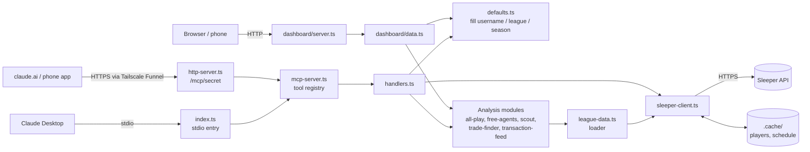

# Sleeper MCP: Project Description

A read-only toolkit for one Sleeper fantasy football league. It has two parts
that share one codebase:

1. **An MCP server** with 23 tools, so you can ask "who should I pick up?",
   "who's lucky?" or "find me a trade" in a normal Claude chat and get answers
   from live league data. It runs two ways:
   - **stdio:** Claude Desktop starts it on your computer.
   - **HTTP:** it runs on a server behind a public HTTPS address (Tailscale
     Funnel) as a claude.ai custom connector, which also makes the tools work
     in the Claude phone app.
2. **A local web dashboard** (`npm run dashboard`): one page with this week's
   matchups, your roster, all-play standings, trending free agents and league
   moves. It refreshes itself during games and works on a phone.

Both use the same Sleeper client, caches and analysis code, so a number in a
chat always matches the number on the dashboard.

Setup and connection steps are in [SETUP.md](SETUP.md).

---

## Contents

1. [Goals and ground rules](#1-goals-and-ground-rules)
2. [Architecture](#2-architecture)
3. [Repository layout](#3-repository-layout)
4. [Data: Sleeper API and caching](#4-data-sleeper-api-and-caching)
5. [Configuration and defaults](#5-configuration-and-defaults)
6. [Tool catalogue](#6-tool-catalogue)
7. [How the analysis works](#7-how-the-analysis-works)
8. [Dashboard](#8-dashboard)
9. [Testing](#9-testing)
10. [Limitations](#10-limitations)
11. [Changes from upstream](#11-changes-from-upstream)
12. [Ideas for later](#12-ideas-for-later)

---

## 1. Goals and ground rules

- **Answer real league questions from live data.** Who to pick up, who to
  trade with, who's good versus lucky, what the opponent's weak spots are.
- **No repeated typing.** Your username and league are set once and used by
  default everywhere.
- **Read-only.** The Sleeper API can't make moves, and the project doesn't try
  to. Nothing scrapes or automates the Sleeper app.
- **Be a good API citizen.** Stay well under Sleeper's ~1000 calls/minute and
  download the 5 MB player database at most once a day.
- **Own the code.** It's a fork of
  [FloSchl8/sleeper-mcp](https://github.com/FloSchl8/sleeper-mcp) (MIT), so it
  can be changed freely. New code follows the existing TypeScript + Zod style,
  and every new tool has tests.

## 2. Architecture



**Three front ends, one core.** The stdio MCP server (`src/index.ts`), the
HTTP MCP server (`src/http-server.ts`) and the dashboard
(`src/dashboard/server.ts`) are thin layers. Both MCP entry points build their
server with the same `createMcpServer()` in `src/mcp-server.ts`. All Sleeper access goes
through `SleeperClient`, and all calculation lives in small modules made of
pure functions that don't touch the network. That split is what makes the
analysis testable offline and keeps the two front ends consistent.

**Request flow (MCP).** Claude calls a tool. `index.ts` passes the name and
arguments to `handleToolCall`. `DefaultsResolver` fills in any missing
`username_or_id`, `user_id`, `league_id` or `season`. The handler validates
the arguments with Zod, fetches through the client, runs the analysis and
returns JSON. Errors come back as `{ success: false, error }` instead of
crashing the server.

**Request flow (dashboard).** The browser loads static files, then calls
`/api/<panel>` for each panel at the same time. The server resolves your
league and user once, then calls the panel function in `dashboard/data.ts`,
which uses the same loader and analysis modules.

**Request flow (HTTP MCP).** claude.ai sends a JSON-RPC POST to
`https://<server>.ts.net/mcp/<secret>`. Tailscale Funnel ends the HTTPS
connection and forwards it to `127.0.0.1:3031`. `http-server.ts` checks the
secret path with a constant-time compare (any other path is a plain 404),
reads the body (1 MB limit), and hands it to a fresh MCP server and SDK
`StreamableHTTPServerTransport` in **stateless** mode with JSON responses.
There are no sessions to store, expire or leak. Each request stands alone,
which suits a single user on a home server. The tools, defaults and caches
are the same as in stdio mode.

## 3. Repository layout

```
sleeper-mcp/
├── src/
│   ├── index.ts              MCP entry point: stdio (Claude Desktop)
│   ├── http-server.ts        MCP entry point: HTTP at /mcp/<secret> (claude.ai, phone)
│   ├── mcp-server.ts         createMcpServer(): tool registry shared by both entry points
│   ├── tools.ts              Tool list: Zod schemas + JSON schemas for Claude
│   ├── handlers.ts           One handler per tool
│   ├── sleeper-client.ts     All HTTP calls, request cache, player + schedule disk cache
│   ├── config.ts             SLEEPER_USERNAME / LEAGUE_ID / DASHBOARD_* from env or .env
│   ├── defaults.ts           Fills missing username, user_id, league_id, season
│   ├── league-data.ts        Loads league, rosters, users, scored weeks, players, schedule
│   ├── season.ts             Shared pure helpers: ppg, byes, opponents, optimal lineup
│   ├── all-play.ts           All-play records, expected wins, luck
│   ├── free-agents.ts        Trending adds minus league rosters
│   ├── scout.ts              Opponent scouting report
│   ├── trade-finder.ts       Position report + win-win trade search
│   ├── transaction-feed.ts   Readable league activity feed
│   ├── types.ts              Sleeper API types
│   ├── utils.ts              Upstream helpers (unchanged)
│   └── dashboard/
│       ├── server.ts         node:http server, static files + JSON API
│       └── data.ts           One function per dashboard panel
├── dashboard/public/         Frontend: index.html, app.js, refresh.js, styles.css
├── test/                     Offline unit tests (node:test), one file per module
├── test.mjs                  Upstream MCP protocol tests (live API)
├── scripts/smoke.mjs         Call any tool against the live API from the terminal
├── .env.example              Config template (copy to .env)
├── SETUP.md                  Install, connect, run, deploy
└── PROJECT.md                This file
```

## 4. Data: Sleeper API and caching

### Endpoints used

All from `https://api.sleeper.app/v1` unless noted. No authentication.

| Endpoint | Used for |
| --- | --- |
| `/state/nfl` | Current season, week, season type |
| `/user/{name}` | Username → user ID |
| `/user/{id}/leagues/nfl/{season}` | Finding your league |
| `/league/{id}` | Name, roster slots, scoring week settings, playoff start |
| `/league/{id}/rosters` | Who owns whom; records; IR and taxi |
| `/league/{id}/users` | Display and team names |
| `/league/{id}/matchups/{week}` | Scores, starters, **per-player points** |
| `/league/{id}/transactions/{week}` | Trades, waivers, FAAB, picks |
| `/players/nfl` | Full player database (~5 MB download, 19 MB on disk) |
| `/players/nfl/trending/add` | League-wide add counts across Sleeper |
| `https://api.sleeper.app/schedule/nfl/regular/{season}` | NFL schedule (undocumented; see below) |

The schedule endpoint isn't in Sleeper's public docs, but it's the same public
API Sleeper's own app uses. The code treats it as optional: if it fails, bye
and opponent info is simply left blank.

### Caching layers

| Layer | What | Lifetime | Why |
| --- | --- | --- | --- |
| Disk: `.cache/players.json` | Player database | 24 h | Sleeper asks for at most one download a day |
| Disk: `.cache/schedule-{season}.json` | NFL schedule | 24 h (5 min for live dashboard panels) | Bye weeks and opponents; game status during games |
| Memory: request cache | Every other GET | 30 s default | Lets parallel dashboard panels share one call |
| Memory: past-week matchups | Weeks before the current one | 1 h | Final scores don't change |
| Memory: trending adds | Trending list | 5 min | Changes slowly |

The request cache also merges identical requests that are in flight at the
same moment, and drops failed requests so they're retried. A full dashboard
load makes about 20 API calls the first time and far fewer after that, nowhere
near the rate limit.

## 5. Configuration and defaults

Settings come from real environment variables first, then a gitignored `.env`
file in the repo folder (found relative to the code, so it works whatever
folder Claude Desktop starts in):

| Variable | Default | Meaning |
| --- | --- | --- |
| `SLEEPER_USERNAME` | (none) | Whose team "my" means |
| `SLEEPER_LEAGUE_ID` | your only league this season | Default league |
| `DASHBOARD_HOST` | `127.0.0.1` | `0.0.0.0` to allow other devices |
| `DASHBOARD_PORT` | `3030` | Dashboard port |

`DefaultsResolver` applies them per tool:

- **Username:** `get_user_info` with no name uses `SLEEPER_USERNAME`.
- **User ID:** tools that need `user_id` accept a numeric ID, a username
  (looked up once and cached), or nothing (uses `SLEEPER_USERNAME`).
- **League:** missing `league_id` → `SLEEPER_LEAGUE_ID` → otherwise your leagues
  this season: one league is used automatically, and several produce an error
  that lists them.
- **Season:** defaults to the current NFL season, not a hardcoded year.

## 6. Tool catalogue

### New in this fork

| Tool | Answers | Key inputs (all optional) |
| --- | --- | --- |
| `get_trending_free_agents` | "Who should I pick up?" | `position`, `lookback_hours`, `limit` |
| `get_all_play_records` | "Who's good and who's lucky?" | `through_week` |
| `get_opponent_scout` | "What's my opponent's weak spot?" | `week` |
| `get_transaction_feed` | "What has my league been doing?" | `since_week`, `type`, `limit` |
| `find_trade_partners` | "Who should I trade with, and for what?" | `target_position`, `limit` |

### Upstream tools (kept)

| Tool | Notes |
| --- | --- |
| `get_user_info`, `get_user_leagues` | Now default to your username and the current season |
| `get_league_info`, `get_league_rosters`, `get_league_users` | Raw league data |
| `get_current_matchups`, `get_matchup_details` | This week's pairings and lineups |
| `get_nfl_state` | Season and week |
| `search_players`, `get_player_details`, `compare_players` | Player lookups |
| `get_trending_players` | Sleeper-wide adds and drops (not league-filtered) |
| `get_waiver_suggestions` | Fixed to skip players rostered anywhere in the league |
| `get_transactions` | Raw transactions for one week |
| `analyze_lineup`, `get_start_sit_advice` | Use Sleeper's search rank as a stand-in for projections (rough) |
| `research_player_status` | Its "web research" results are placeholders from upstream |
| `clear_cache` | Forces a fresh player download |

## 7. How the analysis works

### Season data (`season.ts`, `league-data.ts`)

Weekly matchup objects include `players_points` (points for every rostered
player that week) and `starters_points` (points per starting slot, in roster
slot order). Combined over all **fully scored** regular-season weeks, these
give real per-player, per-slot numbers in your league's own scoring, which is
better than any generic ranking.

- **Scored weeks** end at the league's `last_scored_leg`, so a week still in
  progress never skews the season numbers. Playoff weeks are never counted.
- **Points per game** skips weeks where a player scored exactly 0 (bye,
  injury, inactive), so missed games don't drag a starter down.
- **Optimal lineup:** given players, slots and a value per player, it fills
  the most restrictive slots first (QB, RB, WR, TE, K, DEF, then the WR/RB and
  WR/TE flex slots, then FLEX, then SUPER_FLEX), each time taking the best
  eligible player left. Taking restrictive slots first means a flex spot
  never uses a player a dedicated slot needed.
- **Byes and opponents:** a team missing from a week's schedule is on bye.
  Opponents show as `vs KC` (home) or `@ KC` (away).

### All-play records (`all-play.ts`)

Each week, every team is compared with every other team: higher score is a
win, equal is a tie. Over 9 weeks in a 12-team league, that's 99 "games" per
team, which is a far steadier measure of strength than 9 head-to-head
results.

- **Expected wins** = for each week, the share of teams you outscored, summed
  over weeks. It's how many games your scores "deserved".
- **Luck** = actual head-to-head wins − expected wins. Positive means you won
  more than your scoring earned. Luck adds up to about zero across the league.
- **Actual records** are rebuilt from the same weeks' matchups, not copied
  from the roster settings, so both records always cover the same weeks (this
  matters for `through_week`). They were checked against Sleeper's own records
  for all 12 teams.
- **Median leagues:** if the league also plays everyone against the weekly
  median, those games count in the actual record but not in luck, since score
  alone decides them.

### Trending free agents (`free-agents.ts`)

The tool takes Sleeper's top 100 trending adds and removes any player on any
roster in the league, counting IR and taxi as taken. It also drops positions
the league doesn't start (no linebackers in a non-IDP league), using the
league's roster slots with flex slots expanded. Results stay in add-count
order and keep their Sleeper-wide rank. In this league, about 60 of the top
100 adds are usually taken already, which is why the filter matters.

### Opponent scout (`scout.ts`)

For the week's head-to-head opponent, the report covers:

- **Lineup:** each starting slot with the player, NFL matchup, live points,
  season ppg, and flags: `EMPTY SLOT`, `ON BYE`, `OUT` / `IR` / `DOUBTFUL` /
  `SUSPENDED`, or `Questionable`.
- **Lineup problems:** the flagged starters in one list.
- **Weak spots and strengths:** their season average for each starting slot
  (from `starters_points`) minus the league average for that slot. The three
  most negative are weak spots and the three most positive are strengths. This
  shows patterns such as "their TE slot averages 5 points below the league".
- **Bench depth** by season ppg, and **recent moves** (completed adds, drops
  and trades over the last three weeks, with FAAB bids).

### Trade finder (`trade-finder.ts`)

1. **Value:** season ppg, scaled down when a player has fewer than 3 games
   (one big week doesn't make a star).
2. **Position report:** for QB, RB, WR and TE, your best lineup's average at
   the dedicated slots is ranked against every team. Top third is a strength,
   bottom third is a need. "Surplus" means bench players at a position who'd
   start for at least the weakest team.
3. **Search:** every 1-for-1 swap between your QB/RB/WR/TE players and every
   other team's is tested. For each swap, both teams' best lineups are
   recalculated. A trade is kept only if **your lineup gains at least 0.25 ppg
   and theirs gains too**. Those are trades a rational manager could accept.
4. **Fairness:** value over replacement (VOR) puts positions on one scale.
   Replacement level is the first non-starter at each position league-wide
   (for example the 13th-best QB in a 12-team, 1-QB league). You can't ask for
   more than `max(1.5, 30% of what you send)` VOR above what you give. Without
   this check, "my backup RB for your 22-ppg QB" could pass just because it
   helps both lineups.
5. **Ranking:** ideas are ordered by the *smaller* of the two lineup gains, so
   balanced deals beat lopsided ones. Each partner appears at most twice.

### Transaction feed (`transaction-feed.ts`)

Only completed moves are kept (failed waiver claims are dropped), each one
once, newest first. Each move is split into sides (players added, players
dropped, draft picks received with their original owner, FAAB received). It
gets a one-line summary, for example *"Trade: Team A gets Matthew
Stafford (QB, LAR)…; Team B gets Brock Purdy (QB, SF)"*. The
feed also counts moves by type and by team.

## 8. Dashboard

### Server (`src/dashboard/server.ts`)

- Plain `node:http`, with no web framework and no extra dependencies.
- `GET /` and static files come from `dashboard/public/`.
  `GET /api/{summary|standings|matchups|roster|free-agents|transactions}`
  returns `{ data, updated }`. `GET /api/health` is a liveness check.
- **Read-only:** anything other than GET or HEAD gets `405`.
- **Hardening:** static paths are normalized and must stay inside the public
  folder, which blocks path traversal like `/../.env`. A strict
  Content-Security-Policy allows only same-origin scripts, styles and
  requests. Panel names are checked as the object's own keys, so
  `/api/constructor` can't reach built-in object properties.
- **Failures:** a panel error returns `502 { error }`, and only that panel
  shows the message with a Retry button. The rest of the page keeps working.
- Host and port come from config. If the port is taken, startup fails with a
  clear message.

### Frontend (`dashboard/public/`)

- Plain HTML, CSS and ES modules, with no build step and no CDN. The page
  works offline from Sleeper's own servers except for the API data.
- All content is built with DOM methods (`createElement`, `textContent`),
  never `innerHTML`. Team names are typed by league members and could contain
  markup.
- **Panels:** this week's matchups (yours pinned, live scores, starters left
  to play), your roster (warnings for empty, injured or bye starters, with
  badges), sortable all-play standings (with an all-play bar and colored
  luck), trending free agents, and a filterable moves feed.
- **Refresh:** `refresh.js` decides the interval in US Eastern time: every
  2 minutes during game windows (Thursday night, Sunday 9am to Monday 1am,
  Monday night, Saturdays in December and January, and Friday nights in
  September), and every 15 minutes otherwise. A hidden browser tab isn't
  polled; it catches up when shown again.
- **Theme:** colors are CSS variables with light and dark sets. It follows
  the system by default, and the Theme button cycles auto/light/dark (saved
  in localStorage when available).
- **Responsive:** on wide screens there are two independent column stacks, so
  there are no gaps. Under 960px it's one column in priority order (matchups,
  roster, standings, free agents, moves). Under 600px, secondary columns are
  hidden and the page never scrolls sideways (checked at 375px).

## 9. Testing

`npm test` builds, then runs:

| Suite | Count | Network | Covers |
| --- | --- | --- | --- |
| `test/*.test.mjs` (node:test) | 79 | No | config, defaults, season helpers, all-play, free agents, scout, trade finder, transaction feed, dashboard server, refresh schedule, HTTP MCP endpoint |
| `test.mjs` (upstream) | 13 | Yes | MCP protocol: startup, tool list, calls, error handling |

The unit tests use small hand-built leagues whose answers can be worked out
on paper (for example a 4-team all-play table). The dashboard tests start the
real server on a random port with fake panels, and check headers, routing,
error handling, path traversal and read-only behavior.

For a live check of any tool:
`npm run smoke -- <tool_name> '<json args>'`. Add
`--url https://<host>/mcp/<secret>` to test a deployed HTTP endpoint instead
of starting the stdio server.

## 10. Limitations

- **No projections.** Sleeper's public API has no projections, so "value" is
  points already scored. It doesn't know about a new starting role or a tough
  schedule ahead. That makes the tools better for "who has produced" than
  "who will produce".
- **1-for-1 trades only.** The trade finder doesn't build 2-for-1 deals, and
  it values only the current season (not keepers, dynasty or draft picks).
- **Live "yet to play"** uses NFL game status from the schedule (refreshed
  every 5 minutes), so it can lag a few minutes behind real time.
- **Upstream heuristics:** `analyze_lineup`, `get_start_sit_advice` and
  `compare_players` still rank by Sleeper's search rank, and
  `research_player_status` returns placeholder "web results". Take them
  lightly, or ask Claude to use the newer tools.
- **No login on the dashboard.** It's meant for your own machine, home
  network or Tailscale. It never goes through Funnel.
- **The HTTP endpoint's only lock is its secret path.** claude.ai connects
  without OAuth, so the long random `MCP_HTTP_SECRET` in the URL is the
  protection. Anyone with the full URL can use the (read-only) tools. Change
  the secret if it leaks.

## 11. Changes from upstream

- Fixed: server logs went to stdout and could corrupt the MCP connection.
  All logging now goes to stderr.
- Fixed: the season was hardcoded to 2024.
- Fixed: `test.mjs` exited silently on Windows without running any tests.
- Fixed: `get_waiver_suggestions` only skipped players on your own roster.
- Added: username, league and season defaults through env or `.env`.
- Added: request cache, season matchups loader, NFL schedule cache.
- Added: five analysis tools, the dashboard, 79 offline tests, a smoke-test
  script, and these docs.
- Added: HTTP mode (MCP Streamable HTTP, stateless) for claude.ai custom
  connectors and the phone app, after upgrading the MCP SDK from 0.4 to 1.x.

## 12. Ideas for later

- 2-for-1 trade search, and a "send this offer" text for Claude to draft.
- Playoff odds by simulating the rest of the season from each team's weekly
  scores.
- Weekly recap (high score, biggest blowout, luckiest win) for the league
  group chat.
- Draft-pick values for keeper and dynasty leagues.
- Optional basic auth on the dashboard for access outside your network.
